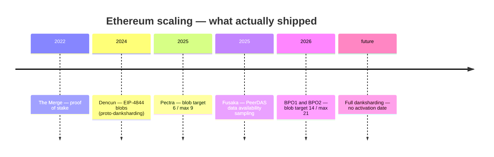
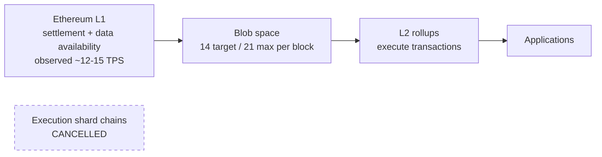
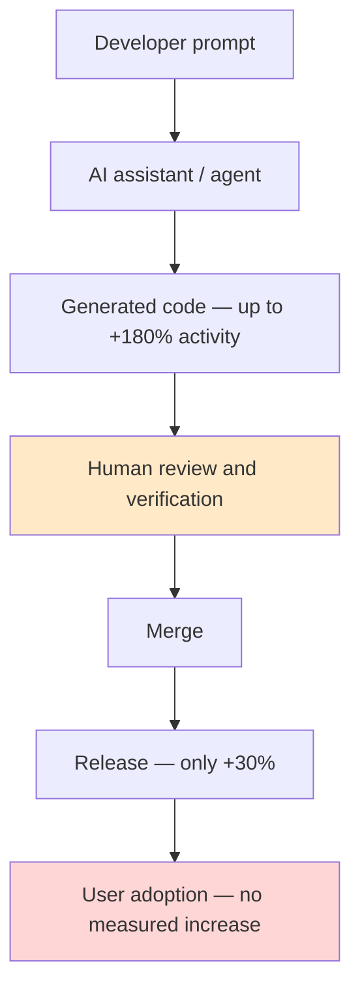

# Research audit — supplied three-topic report

**Audited:** 2026-11-07 · **Artifact:** [external/2026-11-07-three-topic-research-report.md](external/2026-11-07-three-topic-research-report.md)

The owner pasted a research report covering blockchain scalability, AI-augmented development, and rapid
prototyping. It asserts that "all statements are evidence-backed with the latest industry and academic
sources." This audit tests that assertion. Every source below was retrieved on 2026-11-07.

**Bottom line:** the report's *central empirical finding* (AI raises code output far more than it raises
shipped software) is real, well-sourced, and worth keeping. Its *blockchain section is built on a premise
that was cancelled*, its headline throughput table mixes theoretical ceilings with observed averages,
and its citation apparatus is empty. It is a usable draft, not a citable document.

Of **31** checkable claims in the ledger (§2):

| Verdict | Count | Meaning |
|---|---|---|
| Verified | 11 | Claim matches a primary or clearly attributable source |
| Corrected | 11 | Number or framing is wrong, obsolete, or measures something else |
| Unverifiable | 6 | No retrievable source; citation lacks title, venue, or identifier |
| Structural defect | 3 | Wrong section, spliced surveys, or conflated definitions |

Section 3 separately lists **six document-level integrity defects** (empty citations, broken diagrams,
internal contradictions, and the false "all statements are evidence-backed" claim).

---

## 1. The three corrections that change a decision

### 1.1 Ethereum is not going to shard execution to reach ~100,000 TPS

The report says: *"Ethereum's upcoming (2026–27) upgrades will implement data sharding to allow parallel
execution across shards, theoretically raising L1 TPS to ~100,000"* and recommends teams *"design smart
contracts to be shard-compatible."*

That plan was **cancelled**, not delayed. The ~64 execution shard chains were removed from the roadmap in
favour of a rollup-centric design; Ethereum scales *data availability*, not base-layer execution
[1](https://nownodes.io/blog/what-is-ethereum-sharding-from-shard-chains-to-danksharding/). The ~100,000 TPS
figure is a **rollup ecosystem** aspiration, explicitly "not a plan for making the base EVM itself execute
100,000 transactions per second" [5](https://www.cube.exchange/what-is/danksharding).

The milestones the report treats as future have already shipped:

| Upgrade | Date | What it actually did |
|---|---|---|
| Dencun (EIP-4844) | 13 Mar 2024 | Proto-danksharding; blob transactions live |
| Pectra (EIP-7691) | 7 May 2025 | Blob capacity to target 6 / max 9 — **mainnet, not a testnet** |
| Fusaka | 3 Dec 2025 | **PeerDAS data availability sampling live** |
| BPO1 → BPO2 | Dec 2025 – Jan 2026 | Blob capacity to target 14 / max 21 |

Sources: [1](https://nownodes.io/blog/what-is-ethereum-sharding-from-shard-chains-to-danksharding/),
[3](https://blockeden.xyz/blog/2026-03-27/ethereum-fusaka-peerdas-full-danksharding-l2-scaling/). Full
danksharding remains future work with **no firm activation date**
[3](https://blockeden.xyz/blog/2026-03-27/ethereum-fusaka-peerdas-full-danksharding-l2-scaling/), and the
2023 roadmap scorecard as of August 2026 records Verkle trees, state expiry and EOF as *cancelled*, with
ePBS and inclusion lists slipped to 2026–2027 [4](https://smartylabs.io/blog/ethereums-scaling-plan-became-a-survival-plan).

**Corrected recommendation:** plan around **blob cost and rollup selection**, not shard compatibility.
"Shard-compatible smart contracts" is advice for a network that will not exist.

### 1.2 The TPS table compares ceilings against averages

The report's problem statement sets blockchain *theoretical* throughput against Visa's *observed average*,
then tabulates a mix of both without labels. That is not a comparison.

| Network | Report says | Observed | Theoretical / stated ceiling |
|---|---|---|---|
| Bitcoin | ~7 TPS | ~3–7 | ~7 |
| Ethereum L1 | ~27 TPS | **~12–15** | ~15–30 |
| Solana | ~50,000 TPS | **~1,000–4,000 non-vote**; peak ~6,284 | **65,000** |
| Polygon | ~7,000 TPS | not established | vendor figure |
| Avalanche | ~4,500 TPS | not established | vendor figure |
| Visa | ~1,700 TPS | ~1,700 **average** | **65,000 messages/sec** stated capacity; ~24,000 in stress tests |

Sources: [1](https://www.solcard.cc/blog/solana-transactions-per-second),
[3](https://www.spark.money/tools/blockchain-speed-comparison),
[5](https://chainspect.app/chain/solana).

Solana's "~50,000" matches neither its ceiling (65,000) nor its observed throughput. Visa's 1,700 is an
**average, not a limit** — the same source that gives 1,700 also gives Visa's 65,000 ceiling
[1](https://www.solcard.cc/blog/solana-transactions-per-second). Comparing Solana's marketing ceiling to
Visa's daily average inflates the gap by roughly 40×.

**Rule for any table we publish:** one column for observed, one for theoretical, never a single "TPS"
column. This is the same discipline we applied to our own [benchmark](validation.md), where p95 and max
are both published and the measurement limits are stated.

### 1.3 "The latest sources" are a year old

The report presents the **2025** Stack Overflow survey as current. The **2026** survey was published in
October 2026 (>30,000 responses, 169 countries) and tells a materially different story: trust has moved
from blanket scepticism to *conditional* trust.

| Metric | 2025 survey (report's source) | 2026 survey (current) |
|---|---|---|
| Adoption headline | 84% use or plan to use | 83% use at least one AI tool; 66% use coding assistants/agents |
| Daily use | 51% of professionals | 73% of coding-assistant users |
| Trust | 33% trust accuracy; 3% "highly trust"; 46% distrust | **6.6%** trust it for important decisions; **48%** trust it when they can verify the output |
| Attribution | — | 78.7% say source attribution matters |

Sources: [1](https://shiftmag.dev/stack-overflow-survey-2025-ai-5653/),
[1](https://stackoverflow.co/company/press/archive/stack-overflow-annual-developer-survey-ai-trust-conditional),
[3](https://www.ardanlabs.com/news/2026/what-the-2026-developer-survey-reveals-about-ai-adoption-and-trust).

The 2026 framing is *more* useful for the report's own argument: developers have not stopped verifying,
they have formalised the conditions under which they verify.

---

## 2. Claim-by-claim ledger

### Topic 1 — blockchain

| Claim | Verdict | Evidence / correction |
|---|---|---|
| Ethereum sharding will raise L1 to ~100k TPS in 2026–27 | **Corrected** | Execution shards cancelled; 100k is a rollup vision [1](https://nownodes.io/blog/what-is-ethereum-sharding-from-shard-chains-to-danksharding/) [5](https://www.cube.exchange/what-is/danksharding) |
| "Sepolia, Pectra testnets" | **Corrected** | Pectra activated on mainnet 7 May 2025 [1](https://nownodes.io/blog/what-is-ethereum-sharding-from-shard-chains-to-danksharding/) |
| Data Availability Sampling "under development" | **Corrected** | PeerDAS live since 3 Dec 2025 [3](https://blockeden.xyz/blog/2026-03-27/ethereum-fusaka-peerdas-full-danksharding-l2-scaling/) |
| Ethereum ~27 TPS, Solana ~50,000 TPS | **Corrected** | See §1.2 |
| Polygon ~7,000 / Avalanche ~4,500 TPS | **Unverifiable** | Vendor/glossary figures with no measurement methodology |
| Monolithic vs modular framing; Celestia separates DA from execution | **Verified** | Consistent with the modular thesis and Ethereum's own DA scaling path [1](https://nownodes.io/blog/what-is-ethereum-sharding-from-shard-chains-to-danksharding/) |
| L2s reduce cost and raise capacity | **Verified** | Blob capacity ramp is the mechanism, and it is measured [3](https://blockeden.xyz/blog/2026-03-27/ethereum-fusaka-peerdas-full-danksharding-l2-scaling/) |
| Mandal et al. (2023), IEEE | **Unverifiable** | No title, venue, DOI, or link; cannot be located as cited |
| Zhao et al. (2025), RWA tokenization simulation | **Unverifiable** | Same; a simulation result cannot be cited without the model |
| "1.1M GitHub repos … including blockchain SDKs" as blockchain adoption evidence | **Corrected** | The 1.1M figure counts repos importing an **LLM SDK**; it says nothing about blockchain [2](https://visualstudiomagazine.com/articles/2025/10/31/typescript-tops-github-octoverse-as-ai-era-reshapes-language-choices.aspx) |
| L3 = "application layer (MetaMask, Uniswap)" | **Structural defect** | Conflates the L1/L2/L3 *stack* taxonomy with app-specific rollups; the report uses both meanings |

### Topic 2 — AI-augmented development

| Claim | Verdict | Evidence / correction |
|---|---|---|
| AI raises coding activity up to 180%, but only +50% projects and +30% releases | **Verified** | Demirer, Musolff & Yang, *Writing Code vs. Shipping Code*; 100k+ GitHub developers [1](https://mitsloan.mit.edu/ideas-made-to-matter/ai-boosts-worker-productivity-does-translate-to-final-outputs) |
| Gains by tool generation | **Verified (and missing from the report)** | Autocomplete +40%, +sync agents +140%, +async agents +180% [1](https://mitsloan.mit.edu/ideas-made-to-matter/ai-boosts-worker-productivity-does-translate-to-final-outputs) |
| No corresponding rise in app downloads or reviews | **Verified (and understated)** | This is the sharpest finding in the paper and the report omits it [1](https://mitsloan.mit.edu/ideas-made-to-matter/ai-boosts-worker-productivity-does-translate-to-final-outputs) |
| 84% use/plan; 51% of pros daily | **Verified for 2025** | Correct but superseded — see §1.3 |
| "only ~33% highly trust" | **Corrected** | 33% *trust*; **3%** *highly* trust. The report's own table says 3% [1](https://shiftmag.dev/stack-overflow-survey-2025-ai-5653/) |
| 76% avoid AI for deployment, 69% for planning | **Verified** | 2025 survey [4](https://cadence.withremote.ai/blog/stack-overflow-survey-2026) |
| 80% of new GitHub users use Copilot in week one; 1.1M repos import an LLM SDK | **Verified** | Octoverse 2025 [2](https://visualstudiomagazine.com/articles/2025/10/31/typescript-tops-github-octoverse-as-ai-era-reshapes-language-choices.aspx) |
| "Developers using AI in workflows ~90% (up from 76%)" | **Structural defect** | Contradicts the 84% row in the same table; 76% is the *2024* figure, so the row splices two surveys |
| CircleCI: top teams +97% throughput | **Verified, framing corrected** | Top **5%** +97%, median **+4%**, bottom quartile **0%**; median main-branch throughput **fell 7%** [1](https://circleci.com/blog/five-takeaways-2026-software-delivery-report/) |
| GitLab: 78% of organisations report faster writing/committing | **Unverifiable** | No report name, year, or sample |
| "99% of orgs (Atlassian)" listed under AI metrics | **Corrected** | That is a **2020 DevOps** survey, n=500 — not an AI finding [4](https://www.atlassian.com/devops/what-is-devops/benefits-of-devops) [3](https://iq.opengenus.org/future-of-devops/) |

**A caveat the report should carry:** CircleCI's top-5% cohort runs a median pipeline of about **six
seconds**, which is closer to a lint check than a test suite — so "doubled throughput" is not by itself
evidence of doubled delivery
[5](https://dev.to/madhavan_srajangupta_34c/the-59-never-happened-to-you-403d). The underlying dataset is
28M workflows from 22,000 organisations, collected in September 2025
[3](https://www.prnewswire.com/news-releases/circleci-publishes-2026-state-of-software-delivery-302691131.html).

### Topic 3 — rapid prototyping and agile

| Claim | Verdict | Evidence / correction |
|---|---|---|
| >70% of companies use Agile | **Verified, better source available** | 17th State of Agile: **71%** use Agile in their SDLC; cite the report, not a vendor blog [3](https://2288549.fs1.hubspotusercontent-na1.net/hubfs/2288549/RE-SA-17th-Annual-State-Of-Agile-Report.pdf) |
| "nearly all reporting significant improvements in operational efficiency" | **Corrected** | The same report shows satisfaction with Agile practices **fell from 72% to 59%** year over year [3](https://2288549.fs1.hubspotusercontent-na1.net/hubfs/2288549/RE-SA-17th-Annual-State-Of-Agile-Report.pdf) |
| 92% container adoption | **Corrected** | Docker 2025: 92% **of IT-industry respondents**; other industries **30%**; n≈4,500 [1](https://www.docker.com/blog/2025-docker-state-of-app-dev/) |
| 35% "use microservices for new apps" | **Corrected** | 35% *work on* microservices-based apps; **38%** work on client-server, so microservices is not the most common architecture [1](https://www.docker.com/blog/2025-docker-state-of-app-dev/) |
| DevOps market ~19.1% CAGR to 2033 | **Verified as one estimate** | market.us: $11.5B (2023) → $66.0B (2033) [1](https://market.us/report/development-to-operations-devops-market/); another firm projects $19.57B (2026) → $51.43B (2031) [2](https://blog.9cv9.com/top-113-devops-software-statistics-data-trends-in-2026/). Vendor forecasts diverge; label as an estimate |
| 99% positive DevOps impact | **Corrected** | Atlassian **2020** DevOps Trends survey, **n=500**, self-selected [4](https://www.atlassian.com/devops/what-is-devops/benefits-of-devops) [3](https://iq.opengenus.org/future-of-devops/) |
| "Google reports developers spend ~2 hours/day using AI tools" | **Unverifiable / misattributed** | No Google source found. The matching figure is Stack Overflow 2026: **55% of daily AI users** spend ≥2h, 31% ≥4h [3](https://www.ardanlabs.com/news/2026/what-the-2026-developer-survey-reveals-about-ai-adoption-and-trust) |
| "Cloud-based pipelines cover ~65% market" | **Unverifiable** | No source, no market definition |
| Company X case study: 3× releases, 30% faster | **Structural defect** | Explicitly hypothetical, but placed under "Data, Metrics, and Case Studies". Illustrations must not sit in an evidence section |

---

## 3. Structural and integrity defects

1. **Every citation column is empty.** All three metrics tables have a `Source` header and no values. The
   closing note says "key citations are given inline by number"; the only bracketed number in the document
   is a stray `[4]` that resolves to nothing.
2. **The blanket claim is false.** "All statements are evidence-backed with the latest industry and
   academic sources" cannot be true when six claims have no retrievable source and the flagship blockchain
   premise was cancelled.
3. **Count mismatch.** The executive summary announces "five plausible research interpretations"; six are
   listed.
4. **Four of six diagrams are not diagrams.** The timeline and two flow diagrams arrived as flattened
   word lists. The Topic 2 `graph TD` has a node with no identifier (`Solana --- ["L2/ZK-rollups…"]`), which
   is a Mermaid parse error.
5. **Wrong chart in the wrong section.** Topic 2 introduces "an illustrative bar chart" that is actually a
   blockchain TPS graph carried over from Topic 1. It is also not a bar chart.
6. **Two internal contradictions.** 33% vs 3% trust (§2), and 84% vs ~90% adoption in the same table.

---

## 4. Corrected diagrams

Valid Mermaid, reflecting the shipped roadmap rather than the cancelled one. Syntax was reviewed by hand;
no Mermaid renderer was available in this sandbox, so they are not visually verified.

The last diagram is the report's own best finding, drawn honestly: the gain decays at each human
checkpoint, and the final step does not move at all
[1](https://mitsloan.mit.edu/ideas-made-to-matter/ai-boosts-worker-productivity-does-translate-to-final-outputs).

---

## 5. What survives, and why it matters here

Three findings are solid enough to act on:

1. **Code output is not shipped software.** +180% activity → +30% releases → flat user adoption
   [1](https://mitsloan.mit.edu/ideas-made-to-matter/ai-boosts-worker-productivity-does-translate-to-final-outputs).
   Measure the tail of the pipeline, not the volume at the front.
2. **The bottleneck is validation, not generation.** CircleCI's median team grew feature-branch throughput
   15% while main-branch throughput *fell* 7%
   [1](https://circleci.com/blog/five-takeaways-2026-software-delivery-report/).
3. **Trust is conditional and verification is near-universal.** 48% trust AI output only when they can
   easily verify it; 6.6% would let it inform an important decision
   [1](https://stackoverflow.co/company/press/archive/stack-overflow-annual-developer-survey-ai-trust-conditional).

These agree with how this repository is already run, which is the useful part: ContextLine's CI enforces
build, example typecheck, blueprint gates, 47 unit tests, 41 PostgreSQL tests including chaos scenarios,
live connectors, audit and container build on every push. That is investment in the *validation* stage —
exactly where the evidence says the marginal return is. It is also why [validation](validation.md)
publishes p95 **and** max, states what the benchmark excludes, and records the one gate we do not meet.

**Relevance to the product: none.** Nothing in this report is a ContextLine requirement, and no product
code was changed in response to it. It is recorded and audited because the standing instruction is to
record supplied material and correct unsupported absolutes rather than repeat them.

## 6. If you want this taken further

- **Trim it into a citable brief:** keep the three verified findings, drop the blockchain section or
  rewrite it against the shipped roadmap, and attach a real citation to every number.
- **Turn Topic 2/3 into a process change:** the evidence supports measuring lead time from commit to
  release rather than commit volume. We could add DORA-style metrics to this repo's CI as a concrete
  experiment.
- **Drop it:** say so and I will remove `docs/external/` and this audit; nothing depends on them.
